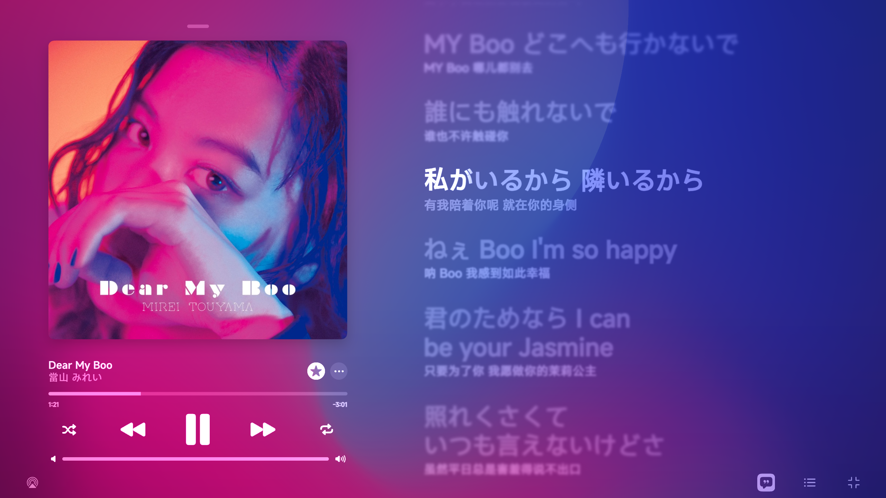
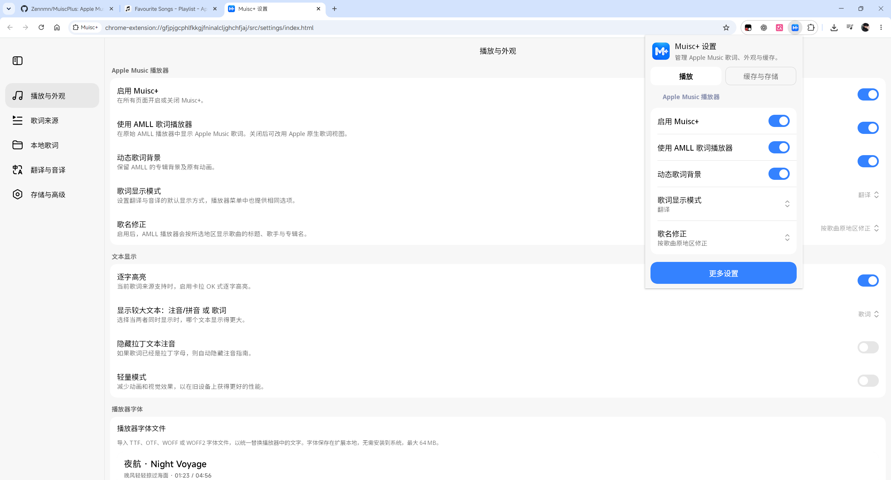

<div align="center">
  
  <h1>Muisc+</h1>
  <p><a href="https://music.apple.com/">Apple Music</a> 网页版歌词与播放器扩展。</p>
  <p><a href="LICENSE"></a></p>
  <p>
    <a href="https://github.com/Zennmn/MuiscPlus/releases/latest">下载</a> ·
    <a href="#安装">安装</a> ·
    <a href="docs/applemusic-amll-testing.md">使用指南</a> ·
    <a href="https://github.com/Zennmn/MuiscPlus/issues">问题反馈</a>
  </p>
</div>

<p align="center">
  <a href="screenshots/amll-player.png"></a>
  <br>
  <sub>AMLL 全屏播放器</sub>
</p>

## 功能

- AMLL 全屏播放器，支持逐字歌词、动态背景和自定义字体。
- 支持 Apple Music 原生歌词、AMLL TTML DB、LunaBeat 和 AmLyrics，也能导入本地 TTML。
- Apple Music 没有歌词或只有纯文本时，从网易云音乐、酷狗音乐和汽水音乐找歌词。顺序可以在设置里改。
- 歌词音译、原生歌词机器翻译、TTML 下载和时间偏移调整。

离线翻译 TTML 见 [TTML 翻译说明](docs/ttml-translation.md)。

<details>
<summary>歌词匹配规则</summary>

有原生逐行或逐字歌词就直接用。只有纯文本时先显示，找到逐行或逐字歌词再替换。匹配时优先逐字，其次是逐行和纯文本；精度一样就保留原生歌词。

</details>

### 设置

<p align="center">
  <a href="screenshots/settings-and-popup.png"></a>
  <br>
  <sub>设置页和快捷弹窗</sub>
</p>

## 安装

如果装了旧版，先停用。

1. 从 [Releases](https://github.com/Zennmn/MuiscPlus/releases/latest) 下载并解压 Chrome 安装包。
2. 在 Chrome 或 Edge 的扩展管理页打开开发者模式，点「加载已解压的扩展程序」。
3. 选择解压后的文件夹，刷新 Apple Music 网页。

### 从源码构建

需要 Node.js 20.19+（20.x）或 22.12+、npm 和 JDK 21。首次打包会下载 Gradle 和界面依赖。在终端中运行：

```sh
git clone https://github.com/Zennmn/MuiscPlus.git
cd MuiscPlus
npm ci
npm run package:chrome
```

构建完成后加载 `dist/youlyplus-amll-chrome`。

## 开发

```sh
npm run dev    # 本地预览，不播放真实音频
npm run build  # 构建播放器和 TTML 解析器
```

## 鸣谢与许可

项目基于 [YouLyPlus](https://github.com/ibratabian17/YouLyPlus)，播放器使用 [AMLL](https://github.com/amll-dev/applemusic-like-lyrics)，设置界面使用 [Miuix](https://github.com/compose-miuix-ui/miuix)。其他依赖及许可见 [THIRD_PARTY_NOTICES.md](THIRD_PARTY_NOTICES.md)。

本项目使用 [AGPL-3.0-only](LICENSE) 许可。
