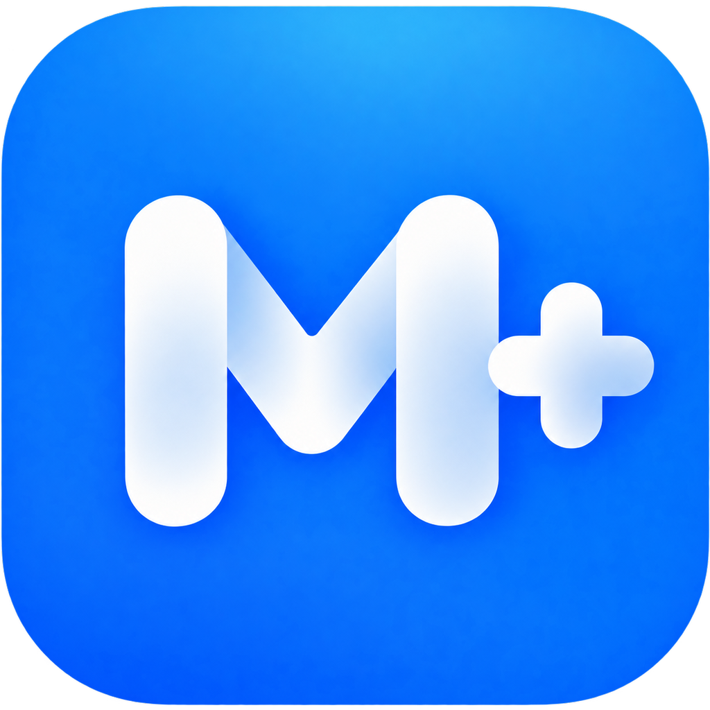

<div align="center">
  
  <h1>Muisc+</h1>
  <p><a href="https://music.apple.com/">Apple Music</a> 网页版歌词与播放器扩展。</p>
  <a href="LICENSE"></a>
  <p>
    <a href="#安装">安装</a> ·
    <a href="docs/applemusic-amll-testing.md">使用指南</a> ·
    <a href="https://github.com/Zennmn/YouLyPlus/issues">问题反馈</a>
  </p>
</div>

## 功能

- AMLL 全屏播放器，支持逐字歌词、背景和字体设置。
- 支持 AMLL TTML DB、LunaBeat、AmLyrics 和 Apple Music 原生歌词，也可以导入本地 TTML。
- 歌词音译、原生歌词机器翻译、TTML 下载和时间偏移调整。

离线翻译 TTML 见 [TTML 翻译说明](docs/ttml-translation.md)。

## 安装

需要 Node.js 20.19+（20.x）或 22.12+、npm 和 JDK 21。首次打包会下载 Gradle 和界面依赖。在终端中运行：

```sh
git clone https://github.com/Zennmn/YouLyPlus.git
cd YouLyPlus
npm ci
npm run package:chrome
```

在 Chrome 或 Edge 的扩展管理页开启开发者模式，选择“加载已解压的扩展程序”，打开 `dist/youlyplus-amll-chrome`，然后刷新 Apple Music 网页。

如果已安装其他版本，请先停用旧版。

## 开发

```sh
npm run dev    # 本地预览，不播放真实音频
npm run build  # 构建播放器和 TTML 解析器
```

## 鸣谢与许可

项目基于 [YouLyPlus](https://github.com/ibratabian17/YouLyPlus)，播放器使用 [AMLL](https://github.com/amll-dev/applemusic-like-lyrics)，设置界面使用 [Miuix](https://github.com/compose-miuix-ui/miuix)。其他依赖及许可见 [THIRD_PARTY_NOTICES.md](THIRD_PARTY_NOTICES.md)。

本项目使用 [AGPL-3.0-only](LICENSE) 许可。
